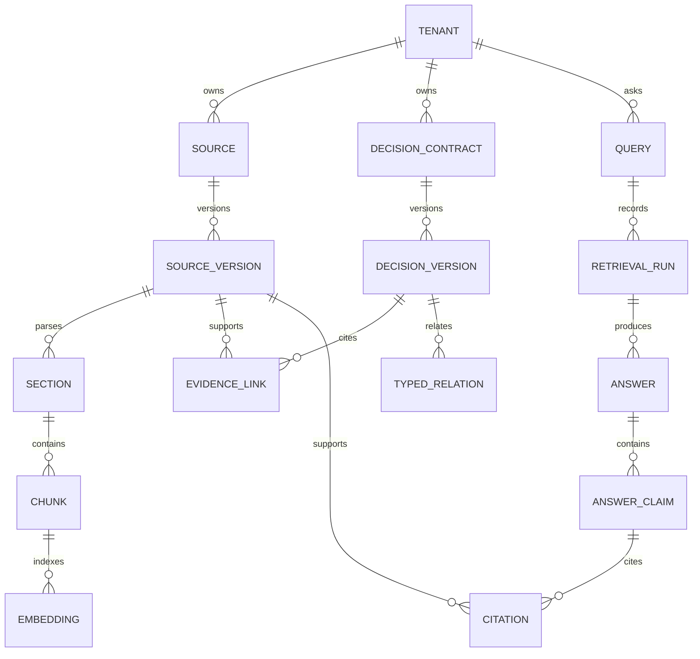

# Phase 1 Data and Lifecycle Model

**Status:** design draft for review; no database has been created.

## Ownership and identity

DecisionTrace owns a separate PostgreSQL database. Every tenant-owned row carries `tenant_id`; request identity and tenant scope come from authenticated server context, never from an untrusted path or document field alone. IDs are opaque UUIDs. Public source-version IDs in the seed corpus are stable fixture labels, not future database primary keys.

## Entity map

## Core tables and invariants

| Table group | Key fields | Required invariant |
|---|---|---|
| `tenants`, `users`, `user_tenant_roles` | tenant ID, subject ID, role, expiry | Role is resolved server-side; no global tenant bypass through object IDs. |
| `sources`, `source_versions`, `source_permissions` | source ID, version number, tenant, origin, content checksum, recorded timestamp, tombstone | New content appends a version. A revoked source becomes unreadable immediately. |
| `ingestion_jobs`, `sections`, `chunks`, `embeddings`, `index_versions` | source-version ID, stable section path, parser/chunker/model/index versions | A job is idempotent by source-version checksum; incompatible indexes are never mixed in one query. |
| `decision_contracts`, `decision_versions`, `assumptions` | decision ID, owner, approver, scope, valid start/end, recorded timestamp, review state | Only approved versions can be authoritative. A correction cannot masquerade as a new decision. |
| `evidence_links`, `typed_relations`, `review_tasks` | exact source-version IDs, relation type, reviewer/action | `corrects`, `supersedes`, `contradicts`, `implements`, `tests`, `measures`, and `supports` are typed and tenant-bound. |
| `queries`, `retrieval_runs`, `answers`, `answer_claims`, `citations` | query time mode, permission snapshot/version, pipeline versions, status, exact citation | A displayed claim has validated authorized citations or is removed; an answer may instead conflict or abstain. |
| `drift_findings`, `audit_events`, `outbox_events` | source/decision pair, state, actor, timestamp, delivery state | Findings link both sides and are reviewable signals. Protected mutations emit audit and outbox records transactionally. |

## Temporal rules

Valid intervals are half-open `[valid_from, valid_to)`; null end means infinity. Recorded history is append-only: for an `as_of` query choose the latest version recorded no later than `as_of`, accounting for correction and revocation events known by then. Never overwrite an earlier version to hide a mistake. For a valid-time question, apply the requested date to the decision's valid interval **and** the recorded-time cutoff to what the system knew. Store UTC instants for recorded events, explicit date/timezone semantics for product-effective dates, and reject ambiguous mixed date input.

The seed case makes the distinction testable: on 10 May, only the first meeting transcript was recorded (one reviewer); the later correction and approved contract establish that the policy valid on 10 May actually required two reviewers. On 20 May, the superseding approved decision disables Cedar overrides. The 19 May boundary still resolves to the earlier decision.

## State transitions

- Source ingestion: `received -> validated -> stored -> parsed -> chunked -> embedded -> linked -> review_required|ready`; terminal `failed`, `quarantined`, `deleted`.
- Decision review: `draft -> in_review -> approved|rejected`; approved versions are immutable. Supersession creates a new decision/version and typed link.
- Answer: `requested -> retrieving -> verifying -> answered|conflict|abstain|denied|failed`.
- Deletion: authorization tombstone is committed before asynchronous index/artifact removal; retries must converge and audit each step.

## Checks before implementation

Migrations must enforce unique `(tenant_id, source_id, version)` and `(tenant_id, decision_id, version)`, nonempty half-open intervals, same-tenant foreign keys or guarded repository methods, checksum presence, and review-state transitions. A threat-to-test map must cover every read path including search, answer cache, export, citations, and traces. The diagram is conceptual and does not prove these constraints exist.

## Retention and deletion proposal

The seed corpus is kept indefinitely as versioned public test data. For future user-imported sources, a tenant administrator must configure a bounded retention period before ingestion; the default for an unconfigured tenant is to reject ingestion rather than promise a deletion window that cannot be met. Deletion writes a tombstone and audit event in one transaction, denies future reads immediately, and queues idempotent cleanup of chunks, embeddings, links, caches, and artifacts. The final retention period, backup handling, and legal hold behavior require review before a real-user release. No private sources exist in the current repository.
